# Diagramas de Flujo y Secuencia del Microservicio de Cuenta y Pagos

> **Microservicio:** Cuenta y Pagos (`Payment Microservice` - Jira: `PMC`)  
> **Versión:** 2.1 (Sintaxis Mermaid estricta, basada en HUs de Jira y Acuerdos Técnicos del PO)  
> **Documento Complementario a:** [ERS Cuenta y Pagos v3.0](../Docs/ERS_Cuenta_Pagos.md)  
> **Formato de Diagramas:** Mermaid (Renderizable nativamente en GitHub, IDEs y visores Markdown)

---

## Índice de Contenidos

1. [Arquitectura Operativa Global del Microservicio](#1-arquitectura-operativa-global-del-microservicio)
2. [Módulo 1: Sincronización Asíncrona y Bandeja de Caja (PMC-5, PMC-26, PMC-27, PMC-28)](#2-módulo-1-sincronización-asíncrona-y-bandeja-de-caja)
   - [1.1 Diagrama de Flujo: Ingesta y Limpieza de Pre-Cuentas](#11-diagrama-de-flujo-ingesta-y-limpieza-de-pre-cuentas)
   - [1.2 Diagrama de Secuencia: Sincronización y Polling de Pre-Cuentas](#12-diagrama-de-secuencia-sincronización-y-polling-de-pre-cuentas)
3. [Módulo 2: Procesamiento Transaccional de Cobros y Pagos Mixtos (PMC-6, PMC-7, PMC-13)](#3-módulo-2-procesamiento-transaccional-de-cobros-y-pagos-mixtos)
   - [2.1 Diagrama de Flujo: Lógica de Cobro, Validación Financiera y Cálculo de Cambio](#21-diagrama-de-flujo-lógica-de-cobro-validación-financiera-y-cálculo-de-cambio)
   - [2.2 Diagrama de Secuencia: Transacción Atómica de Cobro y Evento Outbox](#22-diagrama-de-secuencia-transacción-atómica-de-cobro-y-evento-outbox)
4. [Módulo 3: Ciclo de Vida del Turno de Caja y Arqueo (PMC-8, PMC-9, PMC-29)](#4-módulo-3-ciclo-de-vida-del-turno-de-caja-y-arqueo)
   - [3.1 Diagrama de Flujo: Apertura, Arqueo en Tiempo Real y Cierre Operativo](#31-diagrama-de-flujo-apertura-arqueo-en-tiempo-real-y-cierre-operativo)
   - [3.2 Diagrama de Secuencia: Arqueo sin Bloqueos y Cierre de Caja](#32-diagrama-de-secuencia-arqueo-sin-bloqueos-y-cierre-de-caja)
5. [Módulo 4: Supervisión de Cajas y Cierre Forzado (PMC-16, PMC-30, PMC-32)](#5-módulo-4-supervisión-de-cajas-y-cierre-forzado)
   - [4.1 Diagrama de Flujo: Panel de Supervisión y Cierre Administrativo](#41-diagrama-de-flujo-panel-de-supervisión-y-cierre-administrativo)
   - [4.2 Diagrama de Secuencia: Auditoría y Cierre Forzado de Turno](#42-diagrama-de-secuencia-auditoría-y-cierre-forzado-de-turno)
6. [Módulo 5: Formatos Post-Venta: Tickets Térmicos y Exportación Contable (PMC-14, PMC-15)](#6-módulo-5-formatos-post-venta-tickets-térmicos-y-exportación-contable)
   - [5.1 Diagrama de Secuencia: Generación e Impresión de Ticket Térmico (80 mm)](#51-diagrama-de-secuencia-generación-e-impresión-de-ticket-térmico-80-mm)
   - [5.2 Diagrama de Secuencia: Exportación Contable Masiva en Streaming CSV](#52-diagrama-de-secuencia-exportación-contable-masiva-en-streaming-csv)
7. [Matriz Comparativa: Cambios Respecto a los Diagramas Originales](#7-matriz-comparativa-cambios-respecto-a-los-diagramas-originales)

---

## 1. Arquitectura Operativa Global del Microservicio

Este diagrama ilustra el flujo integral del microservicio adaptado a las decisiones técnicas de Jira: persistencia dual en memoria distribuida (**Redis**) y base de datos relacional (**SQL Server / PostgreSQL**), comunicación asíncrona mediante **MassTransit** y desacoplamiento de pasarelas bancarias y fiscalización para el MVP.

```mermaid
flowchart TD
    %% Estilos de Nodos
    classDef external fill:#f9f9f9,stroke:#666,stroke-width:1px,color:#333;
    classDef broker fill:#fff3e0,stroke:#e65100,stroke-width:2px,color:#e65100;
    classDef memory fill:#e8f5e9,stroke:#2e7d32,stroke-width:2px,color:#2e7d32;
    classDef logic fill:#e1f5fe,stroke:#0277bd,stroke-width:2px,color:#0277bd;
    classDef storage fill:#ede7f6,stroke:#4527a0,stroke-width:2px,color:#4527a0;
    classDef client fill:#fce4ec,stroke:#c2185b,stroke-width:2px,color:#c2185b;

    subgraph Salon_Comandas["Salón y Comandas"]
        Orders["Microservicio de Órdenes"]:::external
    end

    subgraph Bus_Eventos["Bus de Eventos MassTransit"]
        EvtReady["Evento Asíncrono: DinningSessionReadyEvent"]:::broker
        EvtCancel["Evento Asíncrono: DinningSessionCancelledEvent"]:::broker
        EvtPaid["Evento Asíncrono: PaymentCompletedEvent"]:::broker
    end

    subgraph Memoria_Redis["Capa de Memoria Distribuida Redis"]
        BillCache[("Snapshot Pre-cuenta: payments:bill:id")]:::memory
        IndexPending[("Índice de Pendientes: payments:pending_bills_index")]:::memory
    end

    subgraph Microservicio_Pagos["Microservicio de Cuenta y Pagos"]
        ConsumerSync["Consumidor MassTransit: Sincronización Pre-cuentas"]:::logic
        ConsumerCleanup["Consumidor MassTransit: Limpieza por Anulación"]:::logic
        ApiGateway["Kong API Gateway / Extracción JWT Claims"]:::logic
        PaymentService["Servicio de Cobro y Validación Financiera"]:::logic
        ShiftService["Servicio de Turnos y Arqueo"]:::logic
        ExportService["Servicio de Streaming CSV"]:::logic
    end

    subgraph Persistencia_SQL["Persistencia Transaccional ACID"]
        DBSQL[("Base de Datos SQL: TurnoCaja, TransaccionPago, Detalle, Desgloses")]:::storage
    end

    subgraph Puntos_Venta["Puntos de Venta y Supervisión"]
        UIPending["UI: Bandeja de Caja - Polling 10s"]:::client
        UICobro["UI: Pantalla de Cobro y Pagos Mixtos"]:::client
        UITicket["UI: Impresión Ticket 80mm media print"]:::client
        UIShift["UI: Turno, Arqueo y Cierre"]:::client
        UIAdmin["UI: Supervisión y Cierre Forzado"]:::client
        UIExport["UI: Historial y Exportación CSV"]:::client
    end

    %% Flujos de Comandas hacia Redis
    Orders -->|"Comanda lista para pago"| EvtReady
    Orders -->|"Mesa cancelada en salón"| EvtCancel
    EvtReady --> ConsumerSync
    EvtCancel --> ConsumerCleanup
    ConsumerSync -->|"Guarda snapshot TTL 24h"| BillCache
    ConsumerSync -->|"Agrega ID a Set"| IndexPending
    ConsumerCleanup -->|"Elimina clave"| BillCache
    ConsumerCleanup -->|"Remueve ID de Set"| IndexPending

    %% Flujos de la Bandeja de Caja
    UIPending -->|"GET /api/v1/payments/pendings"| ApiGateway
    ApiGateway --> ShiftService
    ShiftService -->|"Consulta rápida sub-20ms"| IndexPending
    ShiftService -->|"Lee snapshots"| BillCache

    %% Flujos de Cobro
    UICobro -->|"POST /api/v1/payments/charge"| ApiGateway
    ApiGateway --> PaymentService
    PaymentService -->|"Verifica turno abierto y saldos"| DBSQL
    PaymentService -->|"Lee snapshot de platillos"| BillCache
    PaymentService -->|"Inserta transacción, desgloses y folio"| DBSQL
    PaymentService -->|"Elimina pre-cuenta pagada"| BillCache
    PaymentService -->|"Remueve de índice"| IndexPending
    PaymentService -->|"Publica evento Outbox"| EvtPaid

    %% Flujos Post-Cobro y Turnos
    PaymentService -->|"201 Created"| UICobro
    UICobro -->|"GET /payments/folio/ticket"| UITicket
    UIShift -->|"Apertura, Arqueo y Cierre"| ShiftService
    UIAdmin -->|"Supervisión y Cierre Forzado"| ShiftService
    ShiftService --> DBSQL
    UIExport -->|"GET /payments/export"| ExportService
    ExportService -->|"IAsyncEnumerable streaming"| DBSQL
```

---

## 2. Módulo 1: Sincronización Asíncrona y Bandeja de Caja

### 1.1 Diagrama de Flujo: Ingesta y Limpieza de Pre-Cuentas
Este diagrama detalla cómo el microservicio procesa eventos provenientes de Órdenes (PMC-5 y PMC-28) asegurando idempotencia y manteniendo actualizado el índice de pre-cuentas en Redis.

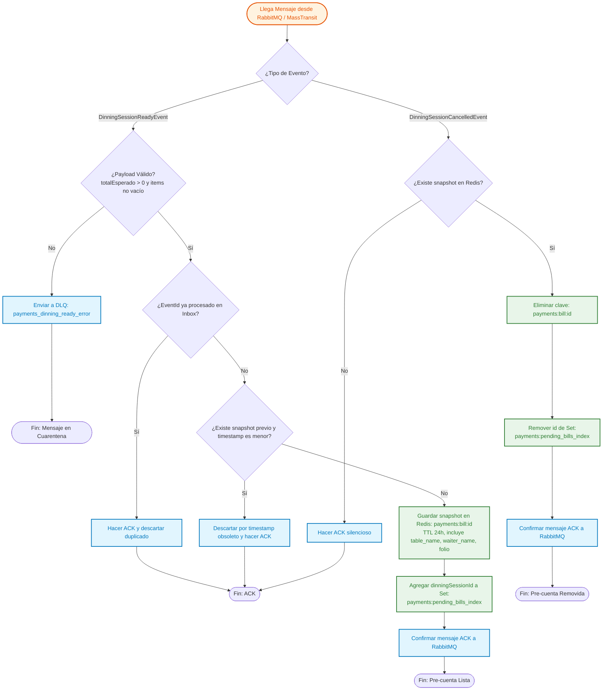

---

### 1.2 Diagrama de Secuencia: Sincronización y Polling de Pre-Cuentas
Ilustra la arquitectura reactiva basada en Polling periódico acordada con el Product Owner (PMC-26 y PMC-27) en lugar de conexiones persistentes por WebSockets.

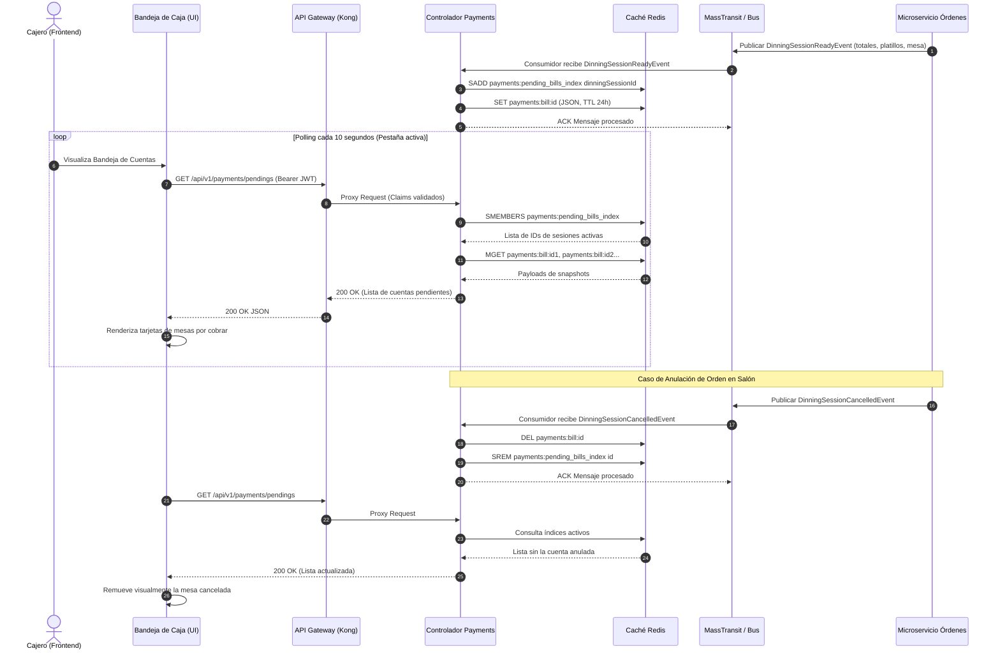

---

## 3. Módulo 2: Procesamiento Transaccional de Cobros y Pagos Mixtos

### 2.1 Diagrama de Flujo: Lógica de Cobro, Validación Financiera y Cálculo de Cambio
Representa las validaciones de negocio estrictas acordadas en PMC-6, PMC-7 y PMC-13 para cobros con un solo método o combinados, reglas de tarjetas, referencias de terminal y persistencia del ingreso real.

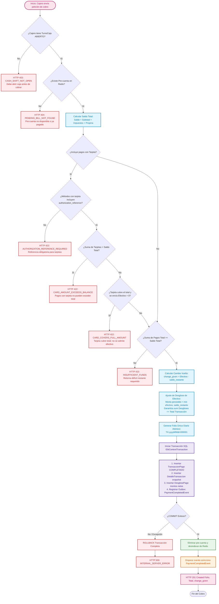

---

### 2.2 Diagrama de Secuencia: Transacción Atómica de Cobro y Evento Outbox
Ilustra el aislamiento transaccional estricto, la consulta de datos en memoria y la publicación atómica hacia el broker de eventos.

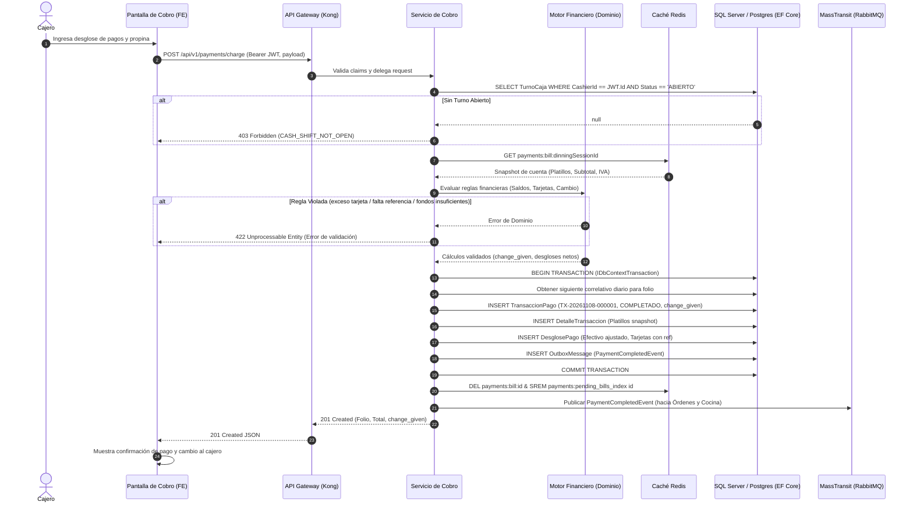

---

## 4. Módulo 3: Ciclo de Vida del Turno de Caja y Arqueo

### 3.1 Diagrama de Flujo: Apertura, Arqueo en Tiempo Real y Cierre Operativo
Muestra los estados del turno de caja del operador (`ABIERTO`, `CERRADO`, `DESCUADRADO`), la prevención de aperturas simultáneas y la comparación ciega de efectivo físico (PMC-8, PMC-9, PMC-29).

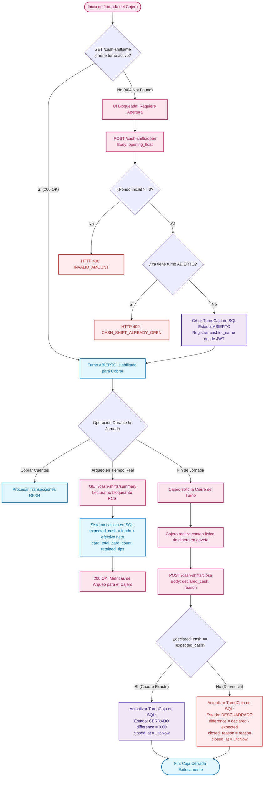

---

### 3.2 Diagrama de Secuencia: Arqueo sin Bloqueos y Cierre de Caja
Ilustra el uso de Read Committed Snapshot Isolation (RCSI) para permitir que los reportes de arqueo no detengan los cobros concurrentes en otras cajas.

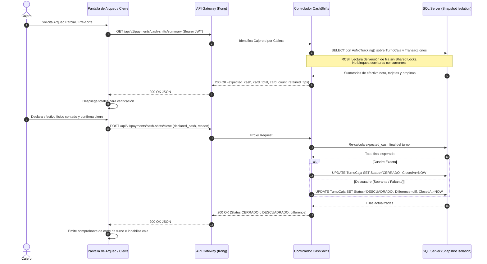

---

## 5. Módulo 4: Supervisión de Cajas y Cierre Forzado

### 5.1 Diagrama de Flujo: Panel de Supervisión y Cierre Administrativo
Describe las capacidades exclusivas de roles `Administrador` y `Gerente` para auditar cualquier caja y forzar el cierre administrativo en caso de abandono o emergencia (PMC-16, PMC-30, PMC-32).

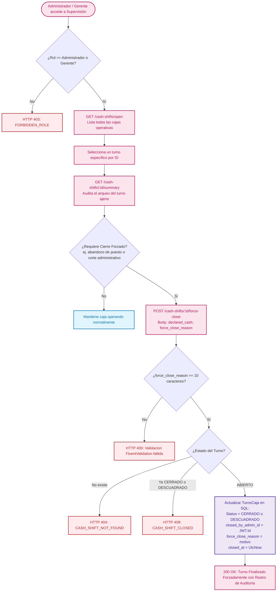

---

### 5.2 Diagrama de Secuencia: Auditoría y Cierre Forzado de Turno

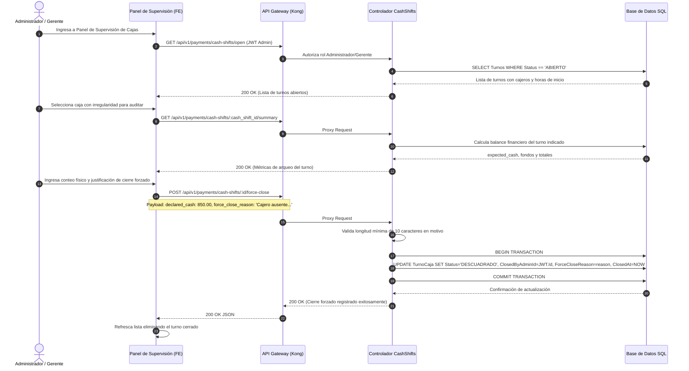

---

## 6. Módulo 5: Formatos Post-Venta: Tickets Térmicos y Exportación Contable

### 6.1 Diagrama de Secuencia: Generación e Impresión de Ticket Térmico (80 mm)
Detalla la obtención de datos inmutables para el renderizado e impresión desde el navegador mediante `@media print` en lugar de binarios propietarios ESC/POS (PMC-14, PMC-21).

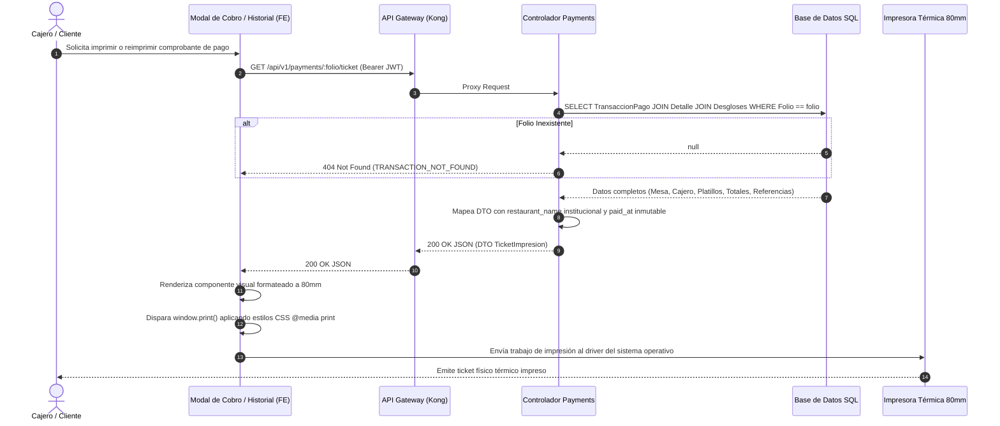

---

### 6.2 Diagrama de Secuencia: Exportación Contable Masiva en Streaming CSV
Demuestra la arquitectura de streaming asíncrono con memoria plana $O(1)$ para descargas de hasta 31 días acordada en PMC-15.

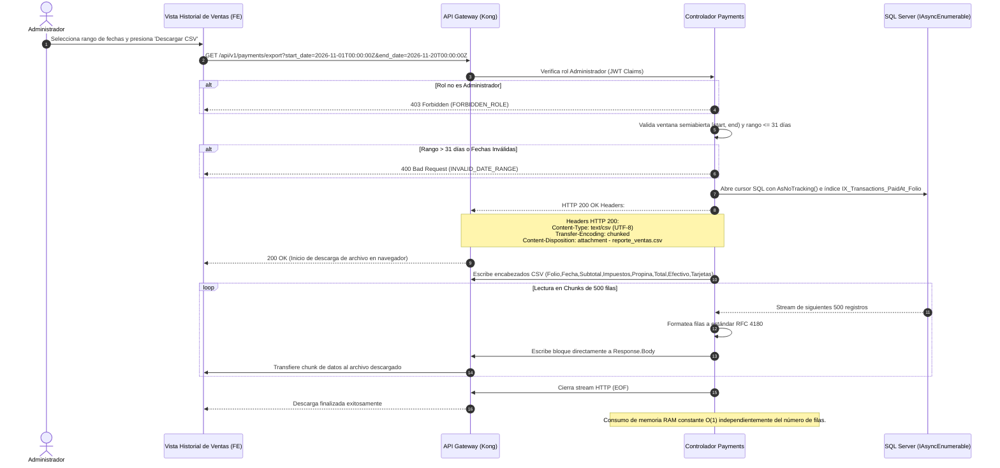

---

## 7. Matriz Comparativa: Cambios Respecto a los Diagramas Originales

| Diagrama Original (.png) | Limitación o Discrepancia del Diagrama Anterior | Corrección y Enfoque en los Nuevos Diagramas |
| :--- | :--- | :--- |
| **`Payment microservice diagram flow operational.png`** | Incluía integración con **PAC SAT (CFDI)** y tablas como `CorteCajaDiario` que no existen en el modelo de base de datos final. Además asumía WebSockets para la bandeja de caja. | **Actualizado en Sección 1:** Se elimina el PAC SAT (post-MVP), se unifica el control de caja en `TurnoCaja` (`CashShift`), se añade **Redis** como caché de pre-cuentas y se adopta **Polling HTTP** cada 10 s. |
| **`Payment microservice sequence diagram.png`** | Contemplaba llamadas de autorización síncrona a "Pasarela Externa" que bloqueaban el backend, así como rollbacks en caso de fallo de red bancario. | **Actualizado en Sección 3.2:** Se elimina la llamada HTTP a pasarelas bancarias. El cobro es local y se valida obligatoriamente la `authorization_reference` física. Se incluye el Outbox Pattern para MassTransit. |
| **`Flujo de Cobro y Pagos Mixtos.png`** | No especificaba el algoritmo de cálculo de cambio ni las restricciones cuando la tarjeta excede el total o cubre el saldo completo. | **Actualizado en Sección 3.1:** Se modela el cálculo exacto de `change_given`, las reglas `CARD_AMOUNT_EXCEEDS_BALANCE` y `CARD_COVERS_FULL_AMOUNT`, y el ajuste con `Math.Min` para el ingreso real. |
| **`Flujo de Arqueo y Corte de Caja.png`** | Mostraba un "Corte de Caja Diario" separado y no contemplaba la lectura no bloqueante (RCSI) ni la posibilidad de consultar turnos de supervisión. | **Actualizado en Secciones 4.1 y 4.2:** Se formaliza el ciclo de vida sobre `TurnoCaja` con estados `CERRADO` o `DESCUADRADO`, fondo inicial, cálculo de métricas en tiempo real y lectura Snapshot. |
| **`Flujo de Facturación Electrónica (Post-Venta).png`** | Situaba la facturación como un flujo del MVP con endpoints de timbrado inmediatos. | **Aclarado en Arquitectura:** La facturación CFDI 4.0 queda formalmente despriorizada para la fase post-MVP. |
| **`Flujo de Cancelación y Extorno (Excepción).png`** | Detallaba la anulación y extornos en pasarelas bancarias con autorización gerencial. | **Aclarado en Arquitectura:** La cancelación de ventas salió del alcance del MVP por decisión del Product Owner (PMC-12 en *Won't Do*, PR #11 cerrada). |
| *(No existía en diagramas .png)* | No existían diagramas para el **Cierre Forzado** de supervisión, la sincronización de pre-cuentas en Redis, ni la exportación contable en streaming. | **Nuevos Diagramas Creados:** Secciones 1.1, 1.2, 5.1, 5.2 y 6.2 cubren la totalidad de estas Historias de Usuario de Jira (PMC-5, PMC-15, PMC-16, PMC-26, PMC-27, PMC-28, PMC-30, PMC-32). |
