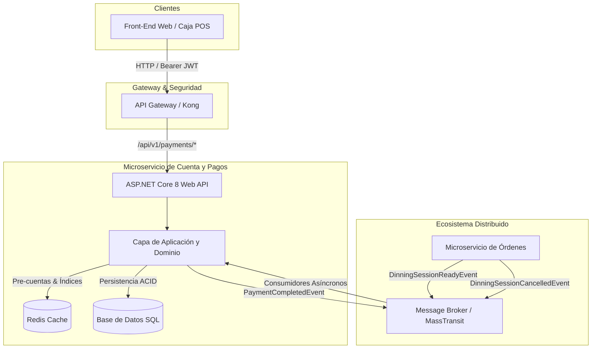
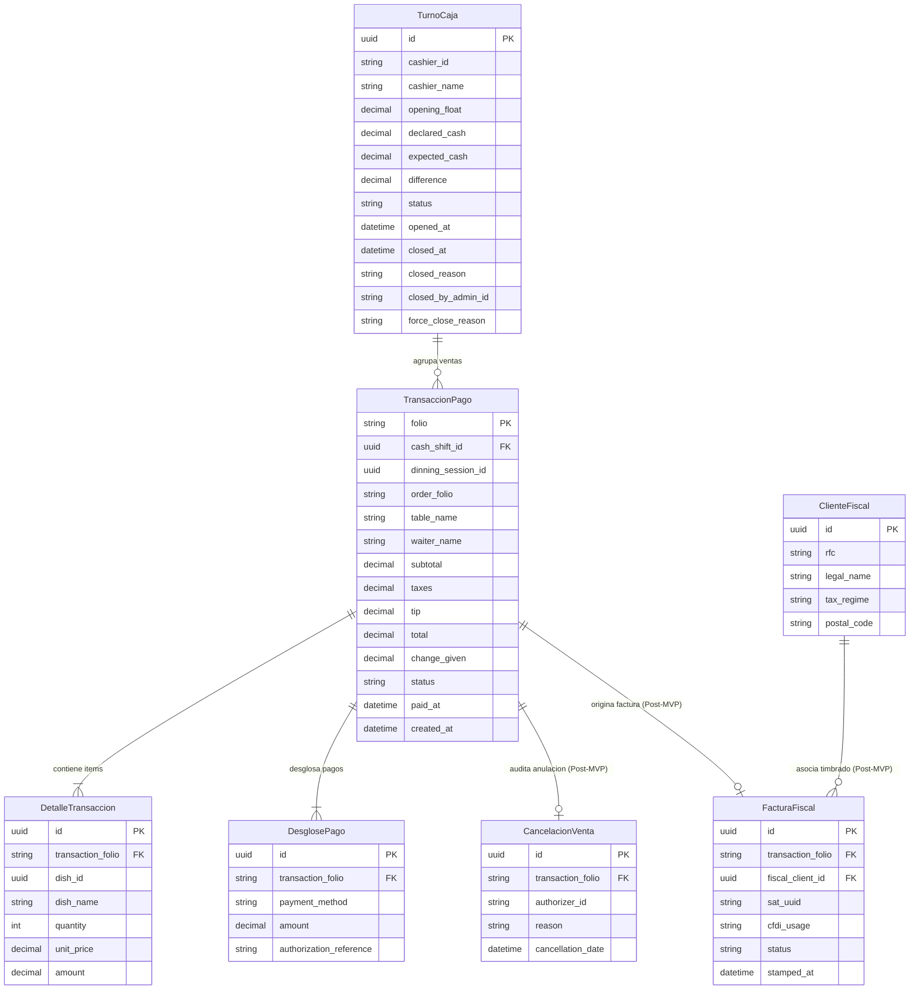

# Especificación de Requisitos de Software (ERS)

> **Microservicio:** Cuenta y Pagos (`Payments Microservice` - Proyecto Jira: `PMC`)  
> **Arquitectura Destino:** C# .NET 8, Entity Framework Core, MassTransit (RabbitMQ / Azure Service Bus), Redis Cache, SQL Server / PostgreSQL  
> **Versión:** 3.0 (Actualizada con Historias de Usuario Jira, Criterios de Aceptación y Acuerdos Técnicos del PO al 08/11/2026)  
> **Estado:** Documento Oficial de Especificación de Requisitos  
> **Audiencia:** Desarrolladores Backend / Frontend, QA Engineers, Tech Lead, Product Owner y Arquitectos de Software.

---

## Control de Versiones del Documento

| Versión | Fecha | Autor / Equipo | Descripción del Cambio |
| :--- | :--- | :--- | :--- |
| **1.0** | 27/09/2026 | Arquitectura inicial | Creación del documento base inicial del microservicio. |
| **2.0** | 27/09/2026 | Equipo de Pagos | Versión extendida con definición de entidades y flujo fiscal preliminar. |
| **3.0** | 08/11/2026 | Tech Lead / Equipo Pagos | **Actualización integral basada en las HUs de Jira (PMC-1 a PMC-32)** y acuerdos con el Product Owner (05/11/2026):<br>1. Estandarización de rutas REST bajo el prefijo unificado `/api/v1/payments` con campos JSON en inglés (`snake_case`) y catálogo de errores tipificados `{code, message}` en español.<br>2. Adopción de **Redis** para sincronización temporal de cuentas por cobrar (`payments:bill:{id}`) y su índice de listado concurrente (PMC-5, PMC-26, PMC-27, PMC-28).<br>3. Sustitución de SSE/WebSocket por **Polling HTTP de baja latencia** para la Bandeja de Caja (PMC-27).<br>4. Exclusión formal de la **Cancelación de Venta (Extorno)** del alcance MVP (PMC-12 en *Won't Do*, PR #11 descartada; estado `CANCELADO` conservado solo a nivel de diseño conceptual).<br>5. Exclusión formal de pasarela bancaria externa síncrona en Backend (el cobro con tarjeta exige validación obligatoria de `authorization_reference`).<br>6. Postergación de la facturación electrónica SAT (CFDI 4.0) a fase post-MVP.<br>7. Inclusión de las operaciones de supervisión: cierre forzado de turno (`force-close`, PMC-16), listado de turnos abiertos (PMC-30) y arqueo por identificador (PMC-32).<br>8. Especificación de reglas matemáticas y financieras para el cálculo de cambio, redondeo de IVA y desgloses contables exactos (PMC-13).<br>9. Definición de contratos DTO para impresión térmica en navegador (PMC-14) y exportación masiva contable en streaming (PMC-15). |

---

## 1. Introducción

### 1.1 Propósito
Este documento define exhaustiva y formalmente los requisitos funcionales, no funcionales, reglas de negocio, contratos de interfaz y esquema de persistencia para el microservicio de **Cuenta y Pagos** (`Payments`). Su objetivo es servir como la única fuente de verdad técnica para la certificación de calidad (QA), desarrollo de software backend y consumo desacoplado desde el frontend y servicios satélite.

### 1.2 Alcance del Sistema
El microservicio centraliza todas las operaciones financieras transaccionales del restaurante:
- **En el Alcance (MVP):**
  - Consumo asíncrono y almacenamiento en caché de comandas listas para cobro emitidas por el microservicio de Órdenes (`DinningSessionReadyEvent`).
  - Consulta y bandeja reactiva de cuentas pendientes mediante índices en Redis y polling HTTP de alta frecuencia.
  - Limpieza de pre-cuentas por cancelación de órdenes (`DinningSessionCancelledEvent`).
  - Control riguroso del ciclo operativo de caja por cajero: apertura con fondo inicial, arqueo ciego/en tiempo real, consulta de turno propio y cierre operativo comparando efectivo físico contra esperado.
  - Funcionalidades de supervisión administrativa: listado de turnos abiertos, arqueo de turnos ajenos por identificador y cierre forzado con registro mandatorio de auditoría (`force-close`).
  - Procesamiento transaccional atómico de cobros simples y mixtos (efectivo, débito, crédito, transferencias).
  - Reglas de negocio financieras para cálculo de cambio (vuelto), validación estricta de límites de tarjetas y persistencia del desglose ajustado al valor real de ingreso.
  - Registro de auditoría e inmutabilidad de tickets mediante snapshots planos de platillos y desgloses.
  - Generación de folios secuenciales diarios protegidos contra condiciones de carrera: `TX-{yyyyMMdd}-{000001}`.
  - Emisión de eventos de pago completado hacia el bus del sistema (`PaymentCompletedEvent`).
  - DTO optimizado para renderizado e impresión de tickets térmicos (80 mm) desde el navegador del cliente.
  - Consulta paginada del historial de ventas con filtros de fecha semiabiertos `[start_date, end_date)`.
  - Exportación contable masiva de ventas en formato CSV por streaming (`Transfer-Encoding: chunked`), asegurando consumo de memoria constante $O(1)$.
- **Fuera del Alcance (Diferido a fases posteriores / Post-MVP):**
  - **Cancelación y Extorno de Transacciones:** Según decisión formal del Product Owner del 05/11/2026 (PMC-12), las cancelaciones no operan en el MVP. Todas las ventas en el MVP se consideran completadas.
  - **Pasarela Bancaria Síncrona:** El backend no se integra directamente con APIs de bancos o terminales POS vía red. El cajero opera la terminal física externa e ingresa la referencia de autorización obligatoria en el payload de cobro.
  - **Facturación Electrónica SAT (CFDI 4.0):** La conexión con el PAC y timbrado fiscal se desarrollará en una fase posterior.
  - **Gestión de Órdenes y Comandas:** La toma de pedidos, adición de platillos y control de mesas reside exclusivamente en el microservicio de Órdenes y Salón.

### 1.3 Glosario de Términos
- **Snapshot (Fotografía Inmutable):** Copia plana de los datos vigentes al momento de la operación (nombres de platillos, precios unitarios, nombre de mesa, mesero, etc.), desacoplada de cualquier cambio futuro en los catálogos de origen.
- **DinningSession:** Sesión de consumo en mesa generada y administrada por el microservicio de Órdenes.
- **Pre-cuenta (Pending Bill):** Estado temporal de una cuenta lista para ser cobrada, sincronizada en memoria de alta velocidad (Redis) antes de su consolidación en base de datos relacional.
- **Arqueo de Caja:** Comparación entre el saldo que debería existir según los registros del sistema (`expected_cash`) y el dinero físicamente contado por el cajero (`declared_cash`).
- **Cierre Forzado:** Terminación administrativa de un turno de caja que un cajero no cerró al finalizar su jornada o ante una contingencia operativa.
- **DLQ (Dead Letter Queue):** Cola de mensajes en el broker donde se aíslan los eventos cuyo procesamiento falló repetidamente o cuyo payload violó el esquema contractual.
- **RCSI (Read Committed Snapshot Isolation):** Nivel de aislamiento en base de datos que permite a las consultas de lectura no bloquear las transacciones de escritura simultáneas.

---

## 2. Descripción General del Sistema

### 2.1 Perspectiva del Producto e Integración
El microservicio opera como un nodo desacoplado en la arquitectura distribuida del restaurante:
1. **Entrada Síncrona:** A través de un API Gateway (Kong). El Gateway se encarga de la validación del token JWT, purga cualquier header sensible inyectado por clientes (`X-User-Id`, `X-Staff-Id`) y reenvía la petición al backend con el header `Authorization: Bearer <token>`.
2. **Entrada y Salida Asíncrona:** Mediante un bus de eventos (RabbitMQ / Azure Service Bus) orquestado con **MassTransit**, implementando el patrón Inbox/Outbox transaccional.
3. **Capa de Caché Operativa:** Instancia distribuida de **Redis**, utilizada para almacenar las pre-cuentas y el índice de pendientes de caja, evitando consultas pesadas y repetitivas a la base de datos transaccional SQL.



### 2.2 Restricciones Técnicas y Arquitectónicas de Diseño
- **Prefijo y Enrutamiento Unificado:** Todos los endpoints HTTP deben exponerse bajo la raíz `/api/v1/payments`. Las rutas en plural y kebab-case (ej. `/cash-shifts/open`, `/pendings`).
- **Nomenclatura Contractual:**
  - Payloads JSON: campos en inglés y convención `snake_case` (ej. `dinning_session_id`, `authorization_reference`, `opening_float`).
  - Respuestas de error estandarizadas: cuerpo `{ "code": "ERROR_CODE", "message": "Mensaje en español" }`.
- **Seguridad y Extracción de Identidad:** La identidad del operador se extrae única y exclusivamente de los *Claims* del JWT en el pipeline de .NET (`ClaimTypes.NameIdentifier`, `ClaimTypes.Role`, `name`). Queda prohibido recibir identificadores de usuario en parámetros de ruta, query strings o en el cuerpo de la petición.
- **Perfiles y Roles:** El sistema reconoce tres roles canónicos:
  - `Administrador`: Acceso total, auditoría, cierre forzado, consultas de todos los turnos y exportación contable en streaming.
  - `Gerente`: Supervisión de turnos, arqueo por identificador y cierre forzado de turnos.
  - `Cajero`: Operación de su propio turno de caja, consulta de pre-cuentas y procesamiento de pagos.
- **Aislamiento de Persistencia:** Pagos no consulta tablas ni bases de datos de otros servicios. Toda la información requerida de platillos, mesas y meseros debe provenir del payload del evento recibido.

---

## 3. Requisitos Funcionales Detallados (RF)

### RF-01: Sincronización Asíncrona de Pre-Cuentas (PMC-5)
- **Descripción:** El sistema se suscribe al bus de eventos para recibir las notificaciones de cuentas listas para cobro emitidas por Órdenes, persistiendo un snapshot temporal en memoria distribuida para que la caja opere sin latencia y de forma autónoma.
- **Precondición:** El broker de mensajería emite el evento con nombre de contrato `DinningSessionReadyEvent`.
- **Estructura del Evento de Entrada:**
  ```json
  {
    "eventId": "uuid-v4",
    "dinningSessionId": "uuid-v4",
    "mesaId": "uuid-v4",
    "meseroId": "uuid-v4",
    "tableName": "Mesa 04",
    "waiterName": "Carlos R.",
    "orderFolio": "#ORD-9938",
    "timestamp": "2026-11-08T22:00:45Z",
    "items": [
      {
        "platilloId": "uuid-v4",
        "nombre": "Tacos al Pastor",
        "cantidad": 2,
        "precioUnitario": 60.00,
        "importe": 120.00
      }
    ],
    "totales": {
      "subtotal": 205.00,
      "impuestos": 32.80,
      "totalEsperado": 237.80
    }
  }
  ```
- **Reglas de Negocio:**
  1. **Validación:** El consumidor verifica que los identificadores sean UUIDs válidos, `totalEsperado > 0`, y que la lista `items` contenga al menos un elemento. Payloads inválidos se envían a la DLQ (`payments_dinning_ready_error`).
  2. **Persistencia en Redis:** Guarda el snapshot con clave `payments:bill:{dinningSessionId}` y un tiempo de expiración (TTL) de 24 horas.
  3. **Índice de Sesiones Pendientes:** Agrega el `dinningSessionId` al set en Redis `payments:pending_bills_index`. Esto permite listar las cuentas pendientes sin ejecutar comandos bloqueantes como `KEYS *`.
  4. **Idempotencia:** Si se recibe un `eventId` ya procesado, se confirma el mensaje (ACK) y se descarta sin escrituras redundantes.
  5. **Sobreescritura de Versiones:** Si llega un nuevo evento con el mismo `dinningSessionId` y con `timestamp` posterior, se actualiza el snapshot. Eventos con timestamp anterior se descartan.
  6. **Cálculo de Impuestos:** El backend valida el subtotal y calcula el IVA sobre el total esperado, redondeando hacia arriba al centavo más cercano.
- **Postcondición:** La pre-cuenta queda disponible en Redis para su cobro y consulta inmediata en la bandeja de caja.

---

### RF-02: Consulta y Listado de Cuentas Pendientes (PMC-26, PMC-27)
- **Descripción:** Proporciona los endpoints de lectura para alimentar la "Bandeja de Caja" del frontend, permitiendo al cajero visualizar todas las mesas pendientes de cobro y consultar el detalle de una en específico antes de cobrar.
- **Rutas y Métodos:**
  - `GET /api/v1/payments/pendings`
  - `GET /api/v1/payments/pendings/{dinning_session_id}`
- **Reglas de Negocio:**
  1. **Lectura desde Memoria:** Los datos se obtienen exclusivamente iterando el índice `payments:pending_bills_index` y recuperando las claves `payments:bill:{id}` en Redis. No se realizan consultas SQL a disco.
  2. **Actualización en Tiempo Real (Decisión PO):** Se descarta el uso de WebSockets o SSE por complejidad de autenticación en proxies y Kong. El frontend ejecuta un **Polling HTTP periódico (cada 10 segundos)** sobre este endpoint cuando la pestaña del navegador está activa.
  3. **Rendimiento:** La respuesta del listado debe procesarse en menos de 20 ms bajo concurrencia de múltiples puestos de caja.
  4. **Respuesta no encontrada:** Si se consulta una sesión específica que ya no existe en el índice (fue cobrada o anulada), retorna HTTP 404 con código `PENDING_BILL_NOT_FOUND`.
- **Estructura de Respuesta (`200 OK` en Listado):**
  ```json
  [
    {
      "dinning_session_id": "a1b2c3d4-e5f6-7890-1234-56789abcdef0",
      "order_folio": "#ORD-9938",
      "table_name": "Mesa 04",
      "waiter_name": "Carlos R.",
      "timestamp": "2026-11-08T22:00:45Z",
      "items_count": 3,
      "subtotal": 205.00,
      "taxes": 32.80,
      "total": 237.80
    }
  ]
  ```

---

### RF-03: Limpieza Asíncrona de Pre-Cuentas por Anulación (PMC-28)
- **Descripción:** Cuando una mesa o comanda es cancelada en el salón antes de realizar el cobro, el sistema debe remover inmediatamente la pre-cuenta de la bandeja de caja.
- **Precondición:** El microservicio de Órdenes publica el evento `DinningSessionCancelledEvent`.
- **Estructura del Evento:**
  ```json
  {
    "eventId": "uuid-v4",
    "dinningSessionId": "uuid-v4",
    "reason": "Mesa cancelada por cliente",
    "timestamp": "2026-11-08T22:15:00Z"
  }
  ```
- **Reglas de Negocio:**
  1. El consumidor de MassTransit recibe el evento y elimina la clave `payments:bill:{dinningSessionId}` de Redis.
  2. Remueve el `dinningSessionId` del set `payments:pending_bills_index`.
  3. Si la clave no existía en Redis (idempotencia o ya expiró), confirma el mensaje (ACK) silenciosamente.
  4. En el siguiente ciclo de polling del frontend (RF-02), la cuenta desaparecerá automáticamente de la interfaz visual del cajero.

---

### RF-04: Procesamiento Transaccional de Cobros Simples y Mixtos (PMC-6, PMC-7, PMC-13)
- **Descripción:** Consolida el pago de una cuenta, admitiendo combinaciones de múltiples métodos de pago (efectivo, tarjetas, transferencias), calculando propinas y cambio en una sola transacción ACID.
- **Ruta y Método:** `POST /api/v1/payments/charge`
- **Precondición:** El cajero autenticado debe tener un turno de caja en estado `ABIERTO`.
- **Contrato de Petición (Request):**
  ```json
  {
    "dinning_session_id": "a1b2c3d4-e5f6-7890-1234-56789abcdef0",
    "tip": 30.00,
    "payments": [
      {
        "method": "TARJETA_CREDITO",
        "amount": 150.00,
        "authorization_reference": "AUTH-489201"
      },
      {
        "method": "EFECTIVO",
        "amount": 150.00,
        "authorization_reference": null
      }
    ]
  }
  ```
- **Reglas de Negocio y Validaciones Financieras Estrictas:**
  1. **Validación de Turno:** Si el usuario no tiene turno abierto en la base de datos, rechaza con HTTP 403 y código `CASH_SHIFT_NOT_OPEN` ("Debe abrir caja antes de cobrar").
  2. **Cálculo del Saldo a Cubrir:**
     $$\text{Saldo Total} = \text{Subtotal} + \text{Impuestos} + \text{Propina}$$
     El subtotal e impuestos se obtienen directamente del snapshot en Redis (RF-01), nunca de datos enviados por el cliente.
  3. **Regla de Tarjetas y Excedentes:**
     - Si la suma de pagos con tarjeta excede el saldo total: rechaza con HTTP 422 `CARD_AMOUNT_EXCEEDS_BALANCE` ("Los pagos con tarjeta no pueden exceder el total de la cuenta").
     - Si el pago con tarjeta cubre exactamente o supera el total y el cajero además envía un monto en efectivo $> 0$: rechaza con HTTP 422 `CARD_COVERS_FULL_AMOUNT` ("La tarjeta cubre el total; no se admite efectivo adicional").
  4. **Referencia Obligatoria en Tarjetas / Terminal:** Todo método distinto a `EFECTIVO` exige obligatoriamente una cadena no vacía en `authorization_reference`. Si se omite, rechaza con HTTP 422 `AUTHORIZATION_REFERENCE_REQUIRED` ("La referencia de autorización es obligatoria para pagos con tarjeta").
  5. **Fondos Insuficientes:** Si la suma total de pagos ingresados es menor al saldo requerido: rechaza con HTTP 422 `INSUFFICIENT_FUNDS` e incluye en el cuerpo el atributo `deficit` con el faltante.
  6. **Cálculo del Cambio (Vuelto) y Persistencia de Ingreso Real:**
     $$\text{change\_given} = \text{Efectivo Recibido} - (\text{Saldo Total} - \text{Total Tarjetas})$$
     - Solo se genera cambio cuando la tarjeta no cubre la totalidad de la cuenta y el efectivo supera el remanente.
     - **Ajuste Contable en Persistencia:** Para garantizar que la sumatoria de las entidades `DesglosePago` coincida al centavo con el `total` de la transacción, el monto registrado en el desglose de efectivo se trunca al valor neto que cubre la cuenta:
       $$\text{Monto Persistido en Desglose (Efectivo)} = \min(\text{Efectivo Recibido}, \text{Saldo Total} - \text{Total Tarjetas})$$
       El monto sobrante entregado al cliente queda documentado en el campo `change_given` de la cabecera `TransaccionPago`.
  7. **Folio Secuencial Diario:** Se genera un folio con formato `TX-{yyyyMMdd}-{000001}` que se reinicia cada día a las 00:00:00 UTC, implementado mediante secuencias SQL atómicas para evitar duplicados en entornos concurrentes.
  8. **Atomicidad Transaccional:** Dentro de una transacción `IDbContextTransaction`:
     - Inserta cabecera `TransaccionPago` (estado `COMPLETADO`).
     - Inserta los registros inmutables en `DetalleTransaccion` basados en el snapshot de platillos de Redis.
     - Inserta los registros en `DesglosePago`.
     - Elimina la sesión de Redis y de su índice de pendientes.
     - Encola en el Outbox transaccional el evento `PaymentCompletedEvent`.
  9. **Doble Cobro:** Si se intenta pagar una sesión ya procesada, retorna HTTP 409 con código `TRANSACTION_ALREADY_PAID`.
- **Contrato de Respuesta (`201 Created`):**
  ```json
  {
    "folio": "TX-20261108-000012",
    "total": 267.80,
    "status": "COMPLETADO",
    "change_given": 32.20,
    "paid_at": "2026-11-08T22:30:15Z",
    "message": "Cobro procesado exitosamente"
  }
  ```

---

### RF-05: Control del Ciclo de Vida del Turno de Caja (PMC-8, PMC-29)
- **Descripción:** Administra la apertura, verificación y cierre del turno operativo de cada cajero.
- **Rutas y Métodos:**
  - `POST /api/v1/payments/cash-shifts/open`
  - `POST /api/v1/payments/cash-shifts/close`
  - `GET /api/v1/payments/cash-shifts/me`
- **Reglas de Negocio:**
  1. **Apertura de Turno:**
     - Exige un valor numérico decimal `opening_float` $\ge 0$.
     - Extrae el `cajero_id` y `cashier_name` directamente del JWT.
     - Si el cajero ya tiene un turno con estado `ABIERTO`, rechaza con HTTP 409 `CASH_SHIFT_ALREADY_OPEN` ("Ya existe un turno de caja abierto").
     - Guarda el registro con estado `ABIERTO` y timestamp de apertura.
  2. **Consulta de Turno Activo (`/cash-shifts/me`):**
     - Permite al frontend validar si el cajero en sesión tiene caja habilitada antes de operar.
     - Si no hay turno abierto para el usuario, retorna HTTP 404 `CASH_SHIFT_NOT_FOUND`.
     - Si existe, devuelve el ID del turno, fecha de apertura y fondo inicial.
  3. **Cierre de Turno Normal:**
     - Requiere la captura obligatoria de `declared_cash` (efectivo físico en gaveta) $\ge 0$.
     - Admite el campo opcional `reason` para justificar discrepancias si se detecta descuadre.
     - El sistema calcula internamente el efectivo esperado:
       $$\text{expected\_cash} = \text{opening\_float} + \sum(\text{Desgloses Efectivo Registrados}) - \sum(\text{change\_given})$$
     - **Determinación de Estado Final:**
       - Si $|\text{declared\_cash} - \text{expected\_cash}| = 0.00$: Marca el turno como `CERRADO`.
       - Si existe diferencia (faltante o sobrante): Marca el turno como `DESCUADRADO` y persiste la discrepancia calculada en `difference`.
     - Inhabilita el turno para procesar cobros subsecuentes y estampa el timestamp `closed_at`.

---

### RF-06: Motor de Arqueo de Caja en Tiempo Real (PMC-9)
- **Descripción:** Permite al cajero en turno consultar el balance financiero acumulado de su jornada en curso para verificaciones operativas o arqueos parciales ciegos.
- **Ruta y Método:** `GET /api/v1/payments/cash-shifts/summary`
- **Reglas de Negocio:**
  1. Identifica el turno `ABIERTO` asociado al operador autenticado.
  2. Realiza agregación SQL eficiente sobre las transacciones confirmadas del turno:
     - `opening_float`: Fondo con el que inició la caja.
     - `expected_cash`: Efectivo que debe existir en caja física.
     - `card_total`: Total acumulado cobrado mediante terminales (débito y crédito).
     - `card_transaction_count`: Número de operaciones ejecutadas con tarjeta.
     - `retained_tips`: Propinas cobradas a través de métodos con tarjeta.
  3. **Lectura No Bloqueante:** Se ejecuta con `AsNoTracking()` bajo aislamiento Snapshot (RCSI), garantizando que las consultas de arqueo no bloqueen la inserción concurrente de nuevos cobros.
- **Estructura de Respuesta (`200 OK`):**
  ```json
  {
    "cash_shift_id": "c92a5b67-8910-4f5c-b1d2-000000000001",
    "cashier_name": "Juan Pérez",
    "opened_at": "2026-11-08T08:00:00Z",
    "opening_float": 1000.00,
    "expected_cash": 4580.00,
    "card_total": 3200.00,
    "card_transaction_count": 14,
    "retained_tips": 350.00
  }
  ```

---

### RF-07: Supervisión de Cajas: Consulta y Arqueo por Identificador (PMC-30, PMC-32)
- **Descripción:** Proporciona a los roles administrativos y de gerencia la capacidad de visualizar todos los turnos abiertos en el restaurante y auditar el arqueo de cualquier turno individualmente.
- **Rutas y Métodos:**
  - `GET /api/v1/payments/cash-shifts/open`
  - `GET /api/v1/payments/cash-shifts/{cash_shift_id}/summary`
- **Reglas de Negocio:**
  1. **Control de Acceso (RBAC):** Restringido estrictamente a roles `Administrador` y `Gerente`. Un usuario con rol `Cajero` recibe HTTP 403 `FORBIDDEN_ROLE`.
  2. **Listado de Turnos Abiertos (`/cash-shifts/open`):** Retorna la lista consolidada de todas las cajas operando actualmente (`cash_shift_id`, `cashier_name`, `opened_at`, `opening_float`).
  3. **Arqueo por Identificador (`/{cash_shift_id}/summary`):**
     - Permite inspeccionar el arqueo de un turno ajeno.
     - Si el turno está `ABIERTO`, calcula los totales en tiempo real con la misma lógica que RF-06.
     - Si el turno ya se encuentra `CERRADO` o `DESCUADRADO`, devuelve HTTP 200 con el arqueo histórico final y su estado definitivo (decisión acordada con el PO).
     - Si el ID no existe en el sistema, retorna HTTP 404 `CASH_SHIFT_NOT_FOUND`.

---

### RF-08: Supervisión de Cajas: Cierre Forzado de Turno (PMC-16)
- **Descripción:** Permite a un Gerente o Administrador cerrar de forma administrativa y mandatoria el turno de un cajero que abandonó su puesto sin realizar el corte correspondiente o ante emergencias de personal.
- **Ruta y Método:** `POST /api/v1/payments/cash-shifts/{cash_shift_id}/force-close`
- **Reglas de Negocio:**
  1. **Autorización:** Exige rol `Administrador` o `Gerente`.
  2. **Contrato de Entrada (Request):**
     ```json
     {
       "declared_cash": 1200.00,
       "force_close_reason": "El cajero presentó emergencia médica y se retiró sin realizar el corte físico."
     }
     ```
  3. **Validación:**
     - El turno debe existir y estar en estado `ABIERTO`. Si ya está cerrado, retorna HTTP 409 `CASH_SHIFT_CLOSED`.
     - `declared_cash` es obligatorio y $\ge 0$.
     - `force_close_reason` es estrictamente obligatorio, con una longitud mínima de 10 caracteres (`MinimumLength(10)`).
  4. **Auditoría Inmutable:** El sistema persiste en la entidad del turno:
     - `closed_by_admin_id`: Identificador del usuario que ejecutó el cierre forzado (obtenido del JWT).
     - `force_close_reason`: Justificación textual ingresada.
     - `closed_at`: Timestamp UTC de la acción.
     - `status`: Calculado como `CERRADO` o `DESCUADRADO` según la comparación de valores.
- **Respuesta (`200 OK`):** Retorna el resumen del turno cerrado forzadamente junto con la diferencia registrada.

---

### RF-09: Consulta de Historial General de Ventas (PMC-10)
- **Descripción:** Endpoint de consulta paginada de tickets cobrados para alimentar la tabla de historial en el panel web.
- **Ruta y Método:** `GET /api/v1/payments?start_date=...&end_date=...&page_index=1&page_size=10`
- **Reglas de Negocio:**
  1. **Lectura Pura e Inmutable:** No ejecuta llamadas a microservicios externos. Proyecta los textos y valores almacenados en `TransaccionPago`, `DetalleTransaccion` y `DesglosePago`.
  2. **Filtro por Rango Temporal:** Las fechas `start_date` y `end_date` operan bajo la convención de **ventana semiabierta $[start\_date, end\_date)$** sobre la fecha de cobro (`paid_at`):
     - La fecha `end_date` es estrictamente exclusiva. Para consultar las ventas de un día completo, el cliente envía el inicio del día siguiente en UTC.
     - Si `start_date >= end_date`, retorna HTTP 400 con código `INVALID_DATE_RANGE` ("La fecha de inicio debe ser anterior a la fecha de fin").
  3. **Paginación:** `page_index` (base 1, default 1), `page_size` (default 10, rango permitido 1 a 50).
  4. **Sin Filtro de Estado:** Dado que la cancelación de ventas quedó fuera del MVP (PMC-12), todas las transacciones consultadas poseen el estado `COMPLETADO`.
- **Estructura de Respuesta (`200 OK`):**
  ```json
  {
    "page_index": 1,
    "page_size": 10,
    "total_count": 145,
    "total_pages": 15,
    "data": [
      {
        "folio": "TX-20261108-000001",
        "cash_shift_id": "c92a5b67-8910-4f5c-b1d2-000000000001",
        "total": 500.00,
        "status": "COMPLETADO",
        "paid_at": "2026-11-08T14:30:00Z",
        "items": [
          { "dish_name": "Corte Ribeye", "quantity": 1, "unit_price": 500.00 }
        ],
        "payment_breakdowns": [
          { "method": "EFECTIVO", "amount": 500.00 }
        ]
      }
    ]
  }
  ```

---

### RF-10: Consulta Detallada de Ticket por Folio (PMC-11)
- **Descripción:** Recupera la totalidad de la información financiera, ítems y métodos de pago de una transacción histórica mediante su folio único.
- **Ruta y Método:** `GET /api/v1/payments/{folio}`
- **Reglas de Negocio:**
  1. Busca la transacción en la base de datos de Pagos.
  2. Si el folio no existe, responde HTTP 404 con código `TRANSACTION_NOT_FOUND` ("El ticket '{folio}' no existe").
  3. Devuelve todos los montos consolidados: `subtotal`, `taxes`, `tip`, `total`, `change_given`, junto con el detalle completo de platillos y desgloses de pago con sus códigos de autorización.

---

### RF-11: Estructura DTO para Impresión de Ticket Térmico 80 mm (PMC-14)
- **Descripción:** Expone un contrato de datos optimizado para el formateo y renderizado de tickets de venta desde el navegador web del punto de venta (`@media print` para impresoras térmicas estándar de 80 mm).
- **Ruta y Método:** `GET /api/v1/payments/{folio}/ticket`
- **Reglas de Negocio:**
  1. **Sin Comandos Binarios Propietarios:** Se elimina cualquier referencia a comandos ESC/POS binarios en el backend. El diseño, fuentes y corte de papel son gestionados por los componentes visuales del frontend mediante CSS `@media print`.
  2. **Inmutabilidad y Coherencia:** Los datos se obtienen de la transacción persistida. La fecha de impresión reportada corresponde a `paid_at` (fecha real de la transacción), garantizando que reimpresiones posteriores sean idénticas al comprobante original.
  3. **Composición del Ticket:** Incluye nombre comercial del restaurante (extraído de la configuración del sistema), nombre de la mesa (`table_name`), nombre del cajero (`cashier_name`), desglose de platillos, desglose impositivo y desglose de formas de pago con sus respectivas referencias bancarias.
- **Estructura de Respuesta (`200 OK`):**
  ```json
  {
    "restaurant_name": "Restaurante FMAT",
    "folio": "TX-20261108-000042",
    "paid_at": "2026-11-08T18:00:00Z",
    "table_name": "Mesa 04",
    "cashier_name": "Juan Pérez",
    "items": [
      {
        "dish_name": "Corte Ribeye",
        "quantity": 1,
        "unit_price": 500.00,
        "amount": 500.00
      }
    ],
    "subtotal": 431.03,
    "taxes": 68.97,
    "tip": 50.00,
    "total": 550.00,
    "payments": [
      {
        "method": "TARJETA_CREDITO",
        "amount": 300.00,
        "authorization_reference": "AUTH-987654"
      },
      {
        "method": "EFECTIVO",
        "amount": 250.00,
        "authorization_reference": null
      }
    ],
    "change_given": 0.00
  }
  ```

---

### RF-12: Exportación Contable Masiva en Streaming CSV (PMC-15)
- **Descripción:** Permite a los administradores descargar en formato plano delimitado por comas (CSV) el consolidado de ventas de un periodo para auditoría y conciliación contable externa.
- **Ruta y Método:** `GET /api/v1/payments/export?start_date=...&end_date=...`
- **Reglas de Negocio:**
  1. **Control de Acceso:** Exclusivo para usuarios con rol `Administrador`. Usuarios sin token reciben HTTP 401; otros roles reciben HTTP 403 `FORBIDDEN_ROLE`.
  2. **Validación de Fechas:**
     - `start_date` y `end_date` son obligatorios.
     - Operan como ventana semiabierta $[start\_date, end\_date)$ sobre `paid_at`.
     - El rango máximo de descarga no puede exceder **31 días naturales**. Si excede o $start\_date \ge end\_date$, retorna HTTP 400 sin consultar la base de datos.
  3. **Arquitectura Streaming de Memoria Constante $O(1)$:**
     - Queda estrictamente prohibido materializar la consulta completa en memoria (ej. `ToList()` o `ToListAsync()`).
     - Debe consumirse mediante `IAsyncEnumerable` o cursores SQL con `AsNoTracking()`.
     - Se escribe directamente hacia el flujo `Response.Body` en bloques (*chunks*) de 500 filas completas bajo el estándar RFC 4180 (UTF-8 sin BOM).
  4. **Encabezados HTTP de Salida:**
     ```http
     Content-Type: text/csv; charset=utf-8
     Content-Disposition: attachment; filename="reporte_ventas_20261101_20261130.csv"
     Transfer-Encoding: chunked
     ```
  5. **Columnas del Archivo:** `Folio,Fecha,Subtotal,Impuestos,Propina,Total,Efectivo,Tarjetas`.
  6. **Tolerancia a Cortes:** Si la base de datos falla antes de iniciar el streaming, responde HTTP 500. Si la conexión se interrumpe a mitad de la transferencia, el pipeline aborta la conexión TCP inmediatamente para evitar que el cliente reciba un archivo truncado como válido.

---

## 4. Requisitos de Datos y Modelo de Persistencia

El microservicio utiliza una estrategia de persistencia dual: persistencia duradera en base de datos relacional (SQL Server / PostgreSQL) administrada con **Entity Framework Core**, y almacenamiento volátil en memoria ultrarrápida mediante **Redis**.

### 4.1 Entidades Relacionales en Base de Datos



#### Descripción Detallada de Entidades del Modelo

| Entidad | Propósito y Ciclo de Vida | Atributos Críticos y Restricciones |
| :--- | :--- | :--- |
| **TurnoCaja** (`CashShift`) | Registra las jornadas de trabajo de cada cajero, controlando montos de apertura, cierres operativos y cierres forzados por supervisión. | `id` (UUID PK), `cashier_id` (varchar(100)), `cashier_name` (varchar(150)), `opening_float` (decimal(18,2)), `declared_cash` (decimal(18,2), null), `expected_cash` (decimal(18,2), null), `difference` (decimal(18,2), null), `status` (Enum: `ABIERTO`, `CERRADO`, `DESCUADRADO`), `opened_at` (datetime), `closed_at` (datetime, null), `closed_reason` (varchar(500), null), `closed_by_admin_id` (varchar(100), null), `force_close_reason` (varchar(500), null). |
| **TransaccionPago** (`PaymentTransaction`) | Cabecera inmutable de cada cobro efectuado. Garantiza trazabilidad de mesa, mesero, orden y sumatorias financieras exactas. | `folio` (varchar(30) PK - `TX-{yyyyMMdd}-{000001}`), `cash_shift_id` (UUID FK), `dinning_session_id` (UUID), `order_folio` (varchar(50), null), `table_name` (varchar(50)), `waiter_name` (varchar(150), null), `subtotal` (decimal(18,2)), `taxes` (decimal(18,2)), `tip` (decimal(18,2)), `total` (decimal(18,2)), `change_given` (decimal(18,2)), `status` (Enum: `COMPLETADO`, `CANCELADO`), `paid_at` (datetime), `created_at` (datetime). |
| **DetalleTransaccion** (`TransactionDetail`) | Snapshot estático e inmutable de los platillos cobrados para auditoría futura sin dependencias de catálogos externos. | `id` (UUID PK), `transaction_folio` (varchar(30) FK), `dish_id` (UUID, null), `dish_name` (varchar(200) plano), `quantity` (int > 0), `unit_price` (decimal(18,2)), `amount` (decimal(18,2)). |
| **DesglosePago** (`PaymentBreakdown`) | Desglosa los métodos de pago aplicados a la transacción. En efectivo registra el monto neto tras cambio; en tarjeta exige referencia externa. | `id` (UUID PK), `transaction_folio` (varchar(30) FK), `payment_method` (Enum: `EFECTIVO`, `TARJETA_DEBITO`, `TARJETA_CREDITO`, `TRANSFERENCIA`), `amount` (decimal(18,2) > 0), `authorization_reference` (varchar(100), null para efectivo, obligatorio para otros). |
| **CancelacionVenta** (`SaleCancellation`) | Rastro de auditoría de extornos (Alcance Post-MVP). | `id` (UUID PK), `transaction_folio` (varchar(30) FK), `authorizer_id` (varchar(100)), `reason` (text), `cancellation_date` (datetime). |
| **ClienteFiscal** (`FiscalClient`) | Catálogo tributario de clientes para facturación electrónica (Alcance Post-MVP). | `id` (UUID PK), `rfc` (varchar(13)), `legal_name` (varchar(250)), `tax_regime` (varchar(10)), `postal_code` (varchar(10)). |
| **FacturaFiscal** (`FiscalInvoice`) | Acuse de timbrado de CFDI 4.0 emitido por el PAC/SAT (Alcance Post-MVP). | `id` (UUID PK), `transaction_folio` (varchar(30) FK), `fiscal_client_id` (UUID FK), `sat_uuid` (varchar(36)), `cfdi_usage` (varchar(10)), `status` (varchar(20)), `stamped_at` (datetime). |

### 4.2 Modelo de Caché y Persistencia en Memoria (Redis)
- **Clave de Pre-cuenta:** `payments:bill:{dinningSessionId}`
  - Tipo: Cadena JSON / Hash serializado.
  - TTL: 86,400 segundos (24 horas).
  - Contenido: Payload completo de `DinningSessionReadyEvent` (mesero, mesa, platillos, subtotal, impuestos, total).
- **Índice de Cuentas Pendientes:** `payments:pending_bills_index`
  - Tipo: Redis Set (`SADD`, `SREM`, `SMEMBERS`).
  - Permite recuperar las sesiones activas en $O(N)$ sin llamadas bloqueantes `KEYS *`.

### 4.3 Índices Críticos de Base de Datos
- `IX_Transactions_PaidAt_Folio` sobre `TransaccionPago(paid_at, folio)`: Optimiza la búsqueda de ventanas semiabiertas en el historial (RF-09) y el streaming masivo del reporte CSV (RF-12).
- `IX_TurnoCaja_Cashier_Status` sobre `TurnoCaja(cashier_id, status)`: Permite resolver en tiempo constante si un cajero ya cuenta con un turno `ABIERTO` o recuperar su turno activo (RF-05).
- `IX_TransaccionPago_CashShiftId` sobre `TransaccionPago(cash_shift_id)`: Optimiza las agregaciones de sumatoria para los arqueos de caja en tiempo real (RF-06, RF-07).

---

## 5. Requisitos No Funcionales (RNF)

- **RNF-01 (Transaccionalidad ACID y Nivel de Aislamiento):**
  Las mutaciones críticas (cobros y aperturas/cierres) deben encapsularse dentro de transacciones atómicas `IDbContextTransaction` de Entity Framework Core. El nivel de aislamiento para lecturas concurrentes de arqueo e historial debe ser **Read Committed Snapshot Isolation (RCSI)** en SQL Server / PostgreSQL, garantizando lecturas consistentes de solo lectura sin bloquear escrituras ni generar *deadlocks*.
- **RNF-02 (Tolerancia a Fallos e Idempotencia en Mensajería):**
  Todos los consumidores asíncronos de MassTransit deben implementar el patrón Outbox/Inbox transaccional respaldado en base de datos. Si llega un evento repetido con el mismo `eventId` o con un `timestamp` anacrónico, debe descartarse inmediatamente garantizando idempotencia estricta. Mensajes malformados deben ser dirigidos a colas de error (DLQ) sin interrumpir el procesamiento de otros mensajes.
- **RNF-03 (Seguridad, Autenticación y RBAC Estricto):**
  1. El backend valida el token JWT inyectado en el encabezado estándar `Authorization: Bearer <token>`.
  2. Los controladores rechazan cualquier petición que intente proveer IDs de usuario o cajero en el cuerpo o en headers personalizados (`X-User-Id`), previniendo suplantación de identidades.
  3. Los roles se evalúan mediante directivas de autorización nativas de ASP.NET Core (`[Authorize(Roles = "...")]`):
     - Endpoints de cobro y caja general: `Cajero`, `Gerente`, `Administrador`.
     - Endpoints de supervisión (cierre forzado, arqueo ajeno, listado de cajas): `Gerente`, `Administrador`.
     - Endpoints contables (exportación CSV): Exclusivo `Administrador`.
- **RNF-04 (Precisión Numérica y Aritmética Financiera):**
  Todos los atributos financieros (montos, subtotales, impuestos, propinas, cambio) deben modelarse estrictamente como tipos de datos `decimal` en C# y `decimal(18,2)` en la base de datos relacional. El uso de tipos en coma flotante (`float`, `double`) está prohibido. El cálculo de IVA se ejecuta sobre el saldo global consolidado y se redondea hacia arriba al centavo ($0.01$).
- **RNF-05 (Eficiencia en Consumo de Memoria para Reportes):**
  La exportación de ventas hacia CSV (RF-12) debe mantener una huella de memoria plana $O(1)$ sin importar el volumen de datos histórico. Se exige el uso de streaming asíncrono sobre `Response.Body` consumiendo bloques de 500 registros con `IAsyncEnumerable`.
- **RNF-06 (Baja Latencia en Operaciones de Caja):**
  Las peticiones de consulta sobre la Bandeja de Caja (`GET /pendings`) no deben superar los **20 ms de latencia en el percentil 95 (P95)** bajo una carga de hasta 50 peticiones de polling concurrentes por segundo, apalancándose en la lectura directa desde Redis.
- **RNF-07 (Estandarización Contractual de Errores):**
  Todas las respuestas de fallo del microservicio deben satisfacer el esquema canónico acordado con el equipo de Frontend:
  ```json
  {
    "code": "CODIGO_DEL_ERROR",
    "message": "Descripción clara y amigable en idioma español."
  }
  ```

---

## 6. Catálogo Canónico de Códigos de Error

| Código HTTP | Código del Error (`code`) | Mensaje Estandarizado (`message`) | Escenario Disparador |
| :--- | :--- | :--- | :--- |
| **400 Bad Request** | `INVALID_DATE_RANGE` | "La fecha de inicio debe ser anterior a la fecha de fin" / "El rango de fechas no puede exceder los 31 días." | Filtro de fechas ilógico o ventana mayor a 31 días en exportación. |
| **400 Bad Request** | `INVALID_PAGINATION` | "Los parámetros de paginación no son válidos." | `page_index < 1` o `page_size` fuera del rango 1 a 50. |
| **401 Unauthorized** | `UNAUTHORIZED` | "Token de autenticación inválido, ausente o expirado." | Petición sin token JWT o firma criptográfica inválida. |
| **403 Forbidden** | `FORBIDDEN_ROLE` | "No cuenta con los permisos necesarios para realizar esta acción." | Un Cajero intenta consultar turnos ajenos o forzar cierres. |
| **403 Forbidden** | `CASH_SHIFT_NOT_OPEN` | "Debe abrir caja antes de cobrar." | Intento de procesar un pago sin tener un turno en estado `ABIERTO`. |
| **403 Forbidden** | `PASSWORD_CHANGE_REQUIRED` | "Debe actualizar su contraseña antes de operar el punto de venta." | Claim de usuario indicando expiración de credenciales. |
| **404 Not Found** | `CASH_SHIFT_NOT_FOUND` | "El turno de caja no existe." / "No cuenta con un turno de caja abierto." | Consulta de turno inexistente en base de datos. |
| **404 Not Found** | `TRANSACTION_NOT_FOUND` | "El ticket '{folio}' no existe." | Consulta o reimpresión de un folio que no existe en el sistema. |
| **404 Not Found** | `PENDING_BILL_NOT_FOUND` | "La pre-cuenta solicitada no se encuentra disponible." | La sesión de consumo no existe en el caché de Redis. |
| **409 Conflict** | `CASH_SHIFT_ALREADY_OPEN` | "Ya existe un turno de caja abierto." | Intento de abrir un turno teniendo ya uno activo. |
| **409 Conflict** | `CASH_SHIFT_CLOSED` | "El turno de caja ya se encuentra cerrado." | Intento de forzar el cierre de un turno que ya concluyó. |
| **409 Conflict** | `TRANSACTION_ALREADY_PAID` | "La transacción ya ha sido pagada previamente." | Cobro duplicado de una comanda ya confirmada en el sistema. |
| **422 Unprocessable Entity** | `INSUFFICIENT_FUNDS` | "El monto de los pagos no cubre el total de la cuenta." | La suma de métodos de pago es menor al total exigido. |
| **422 Unprocessable Entity** | `CARD_AMOUNT_EXCEEDS_BALANCE` | "Los pagos con tarjeta no pueden exceder el total de la cuenta." | El monto registrado con tarjeta supera el saldo a pagar. |
| **422 Unprocessable Entity** | `CARD_COVERS_FULL_AMOUNT` | "La tarjeta cubre el total; no se admite efectivo adicional." | La tarjeta cubre el 100% de la cuenta y se incluye efectivo $> 0$. |
| **422 Unprocessable Entity** | `AUTHORIZATION_REFERENCE_REQUIRED` | "La referencia de autorización es obligatoria para pagos con tarjeta." | Pago con tarjeta o transferencia sin código de autorización. |
| **500 Internal Server Error** | `INTERNAL_SERVER_ERROR` | "Ocurrió un error inesperado al procesar la solicitud." | Caída de infraestructura o excepción no controlada en el pipeline. |

---

## 7. Matriz de Trazabilidad: Historias de Usuario (Jira) ⟷ Requisitos ERS ⟷ Decisiones Técnicas

| Clave Jira | Tipo | Resumen del Requerimiento en Jira | Requisito en ERS | Estado en Jira | PRs / Acuerdos Técnicos Clave |
| :--- | :--- | :--- | :--- | :--- | :--- |
| **PMC-5** | Historia | BE - Sincronización de cuenta por cobrar | **RF-01** | Ready for QA | PR #2. Consumidor MassTransit de `DinningSessionReadyEvent`. Cache Redis `payments:bill:{id}` con TTL 24h y set de índices de pendientes. Nombres de mesa y mesero. |
| **PMC-6** | Historia | BE - Procesamiento de cobro de un solo método y emisión de evento | **RF-04** | Ready for QA | Ruta `POST /api/v1/payments/charge`. Folio diario `TX-{yyyyMMdd}-{000001}`. Persistencia de subtotal, IVA, propina y cambio. Emisión de `PaymentCompletedEvent`. |
| **PMC-7** | Historia | BE - Procesamiento de cobros mixtos y validaciones estrictas | **RF-04** | Ready for QA | Se des-scopia pasarela bancaria y Polly (PR #19 cerrada). Validación obligatoria de `authorization_reference` en pagos no efectivo. |
| **PMC-8** | Historia | BE - Gestión de Turno de Caja (Apertura y Cierre) | **RF-05** | Ready for QA | Rutas `/cash-shifts/open` y `/cash-shifts/close`. Registro de `cashier_name` desde JWT. Validación contra `expected_cash` y estados `CERRADO`/`DESCUADRADO`. |
| **PMC-9** | Historia | BE - Motor de cálculo para arqueo de caja en tiempo real | **RF-06** | Ready for QA | Ruta `GET /cash-shifts/summary`. DTO con `opening_float`, `expected_cash`, transacciones de tarjeta y propinas retenidas. Lectura sin bloqueos (RCSI). |
| **PMC-10** | Historia | BE - Consulta de historial general (Paginación y Filtros) | **RF-09** | Ready for QA | PR #9. Ruta `GET /api/v1/payments`. Ventana de fechas semiabierta `[start_date, end_date)`. Paginación indexada. Sin filtro de estado cancelado (todas completadas). |
| **PMC-11** | Historia | BE - Detalle inmutable del Ticket | **RF-10** | Ready for QA | PR #8. Ruta `GET /api/v1/payments/{folio}`. Proyección de platillos y desgloses de pago sin consultas externas. |
| **PMC-12** | Historia | BE - Cancelación de Venta con Autorización | **RF-13** | Finalizada (*Won't Do*) | **Decisión PO (05/11/2026): Fuera del MVP**. PR #11 cerrada sin merge. No se habilitan endpoints de cancelación en MVP. |
| **PMC-13** | Historia | BE - Cálculo de Cambio (Vuelto) y Persistencia Exacta | **RF-04** | Ready for QA | PR #13. Servicio de dominio `ChargeCalculationService`. Reglas de desborde de tarjeta, cálculo de vuelto exacto y limitación del desglose de efectivo con `Math.Min`. |
| **PMC-14** | Historia | BE - Estructura DTO para Ticket Térmico y Reimpresión | **RF-11** | Ready for QA | PR #6. Ruta `GET /payments/{folio}/ticket`. Optimizado para `@media print` de navegador (80 mm). Inclusión de mesa, mesero, restaurante y referencias. |
| **PMC-15** | Historia | BE - Exportación Contable Masiva (CSV Streaming) | **RF-12** | Ready for QA | PR #7 / #21. Ruta `GET /payments/export`. Exclusivo `Administrador`. Streaming por bloques de 500 filas en `Response.Body` con memoria $O(1)$. Máximo 31 días. |
| **PMC-16** | Historia | BE - Cierre forzado de un turno de caja (Supervisión) | **RF-08** | Ready for QA | Ruta `POST /payments/cash-shifts/{id}/force-close`. Roles `Administrador` y `Gerente`. Justificación obligatoria (`force_close_reason` $\ge 10$ caracteres). |
| **PMC-18** | Historia | Transversal - Configuración de Tokens, HTTP y Auth | **RNF-03, RNF-07** | TReady for QA| Definición transversal del PO (05/11/2026): Rutas `/api/v1/payments`, JWT sin IDs en body, campos `snake_case`, errores `{code, message}`, roles canónicos. |
| **PMC-26** | Historia | BE - Listado de Cuentas Pendientes (Bandeja de Caja) | **RF-02** | Ready for QA | Rutas `GET /payments/pendings` y `GET /payments/pendings/{id}`. Consulta exclusiva sobre Redis sin tocar SQL. |
| **PMC-27** | Historia | BE - Notificaciones en Tiempo Real para Bandeja de Caja | **RF-02** | Ready for QA | **Decisión PO (05/11/2026): Polling HTTP cada 10s**. Se eliminan SSE y WebSockets para simplificar arquitectura y seguridad en gateway. |
| **PMC-28** | Historia | BE - Limpieza de Cuentas por Anulación de Órdenes | **RF-03** | Ready for QA | Consumidor MassTransit de `DinningSessionCancelledEvent`. Remueve la pre-cuenta y la desindexa de Redis. |
| **PMC-29** | Historia | BE - Consulta de Turno de Caja Actual | **RF-05** | Ready for QA | Ruta `GET /cash-shifts/me`. Determina si el cajero en sesión tiene turno abierto o debe ser bloqueado hasta abrir caja. |
| **PMC-30** | Historia | BE - Listado de Turnos Abiertos (Panel Supervisión) | **RF-07** | Ready for QA | Ruta `GET /cash-shifts/open`. Exclusivo `Administrador` y `Gerente`. Lista cajas en operación en tiempo real. |
| **PMC-32** | Historia | BE - Arqueo de un turno de caja por id (supervisión) | **RF-07** | Ready for QA | Ruta `GET /cash-shifts/{id}/summary`. Permite a supervisores consultar el arqueo de cualquier turno (abierto o cerrado). |

---

## 8. Conclusiones y Próximos Pasos de Implementación

1. **Alineación con el Repositorio de Código:** Se debe actualizar la configuración del pipeline y la documentación de Swagger/OpenAPI del microservicio para reflejar la totalidad de rutas bajo `/api/v1/payments`.
2. **Coordinación con el Equipo de Órdenes:** Asegurar que el evento `DinningSessionReadyEvent` incluya los campos confirmados `table_name`, `waiter_name` y `order_folio`, y verificar la publicación de `DinningSessionCancelledEvent`.

