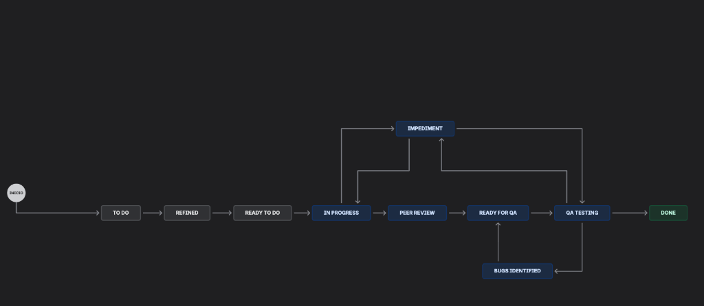
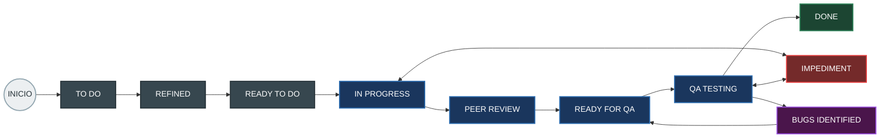
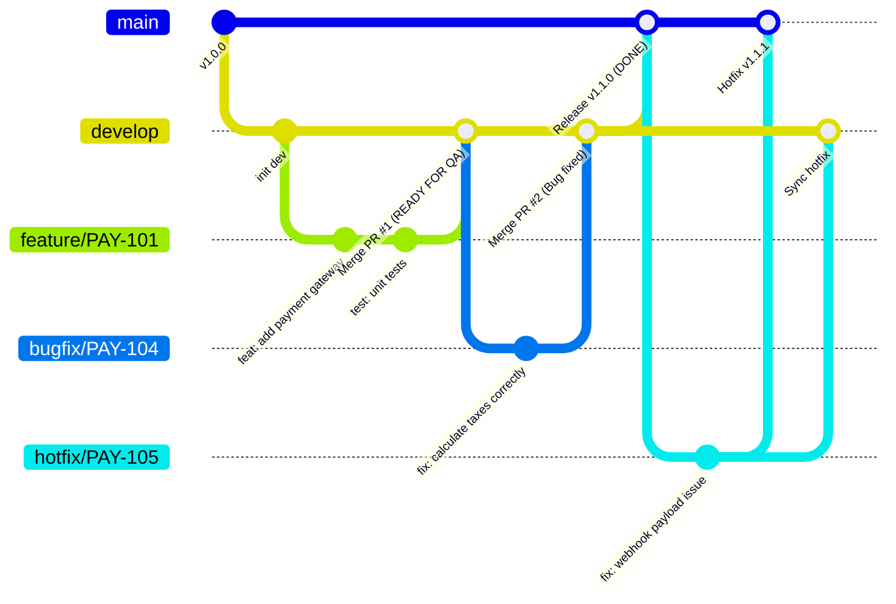

# Guía de Flujo de Trabajo (Jira Workflow), Estrategia de Branching y Convención de Commits

> **Microservicio / Proyecto:** Payments-Docs (VyV Pagos)  
> **Versión:** 1.0.0  
> **Audiencia:** Desarrolladores, QA Engineers, Tech Leads, Product Owners y Scrum Masters.

---

## 1. Introducción y Objetivos

El propósito de este documento es estandarizar el ciclo de vida del desarrollo de software en el equipo, garantizando:
- **Trazabilidad de extremo a extremo:** Vincular cada requerimiento de negocio desde la Historia de Usuario (HU) en Jira hasta el código fuente y las pruebas de calidad.
- **Claridad operativa:** Conocer con exactitud qué significa cada estado del tablero y qué acciones se requieren para avanzar.
- **Calidad y orden en Git:** Mantener un historial de ramas limpio, estandarizado y libre de conflictos gracias a convenciones claras de branching y commits.

---

## 2. Flujo de Trabajo en Jira (Lifecycle Workflow)

El flujo de trabajo describe las etapas por las que transita una Historia de Usuario (HU), Tarea Técnica, Documento o Bug desde su creación hasta su entrega final completada.

### 2.1. Diagrama de Flujo





---

### 2.2. Definición Detallada de Estados

| # | Estado | Responsable Principal | Descripción y Criterios de Entrada/Salida |
|---|---|---|---|
| **0** | **INICIO** | Product Owner / Scrum Master | Punto de partida del elemento de trabajo. Creación inicial del ticket en el backlog general. |
| **1** | **TO DO** | Product Owner / Equipo | El ticket está priorizado en el Product Backlog. Aún requiere análisis técnico o funcional previo a ser planificado para un Sprint. |
| **2** | **REFINED** | PO / Equipo de Desarrollo / QA | La historia ha pasado por sesión de Refinamiento (*Grooming*). Cuenta con descripción funcional clara, criterios de aceptación (formato Gherkin/Dado-Cuando-Entonces) y estimación preliminar. |
| **3** | **READY TO DO** | Scrum Master / Tech Lead | Cumple con el **Definition of Ready (DoR)**. Está 100% lista para ser comprometida y tomada en el Sprint Backlog. No tiene bloqueos de diseño, dependencias ni dudas funcionales. |
| **4** | **IN PROGRESS** | Desarrollador | El desarrollador asignado ha creado la rama correspondiente en Git y se encuentra escribiendo código o creando la documentación correspondiente. |
| **5** | **PEER REVIEW** | Tech Lead / Pares Desarrolladores | El desarrollo ha finalizado y cuenta con pruebas unitarias. Se ha creado el Pull Request (PR) y está a la espera de revisión y aprobación por pares (mínimo 1-2 approvals). |
| **6** | **READY FOR QA** | Desarrollador / DevOps | El PR ha sido aprobado y fusionado (*merged*) a la rama de integración/QA (`develop` o `staging`). El despliegue en el entorno de pruebas fue exitoso y el ticket queda listo para que QA inicie certificación. |
| **7** | **QA TESTING** | QA Engineer | El equipo de QA está ejecutando las matrices de prueba, validaciones funcionales, casos borde, pruebas de regresión y no funcionales en el ambiente de pruebas. |
| **8** | **DONE** | PO / QA / Tech Lead | El ticket cumple con el **Definition of Done (DoD)**: probado satisfactoriamente, documentado, sin bugs abiertos y validado para su liberación a producción. |

---

### 2.3. Flujos de Excepción y Bloqueos

#### A. Estado: `IMPEDIMENT` (Impedimento o Bloqueo)
Este estado suspende temporalmente el avance del ticket debido a factores externos o bloqueos técnicos:
- **Desde `IN PROGRESS`:**
  - *Causas comunes:* Falta de credenciales, accesos a APIs de terceros caídas/sin contrato, dudas funcionales bloqueantes, dependencias con otros servicios no disponibles.
  - *Acción:* El desarrollador pasa el ticket a **IMPEDIMENT**, deja un comentario en Jira detallando la causa exacta y etiqueta al Scrum Master / Tech Lead / PO.
  - *Retorno:* Una vez resuelto el bloqueo, el ticket vuelve inmediatamente a **IN PROGRESS**.
- **Desde `QA TESTING`:**
  - *Causas comunes:* El ambiente de QA está inestable o caído, datos de prueba no parametrizados, fallos de conectividad con pasarelas de pago externas en sandbox.
  - *Acción:* El QA documenta el impedimento del entorno y notifica al equipo de DevOps o soporte.
  - *Retorno:* Restablecido el ambiente o insumo, el ticket regresa a **QA TESTING**.

#### B. Estado: `BUGS IDENTIFIED` (Defectos Encontrados en Pruebas)
- **Disparador:** Durante la fase de **QA TESTING**, si uno o más criterios de aceptación fallan o se detectan errores regresivos o no contemplados.
- **Acción:**
  1. El QA documenta el bug (pasos para reproducir, resultado esperado, resultado obtenido y evidencias en Jira).
  2. El ticket transiciona a **BUGS IDENTIFIED**.
  3. El desarrollador toma la corrección en su rama correspondiente (`bugfix/...`).
  4. Realiza los ajustes necesarios, valida localmente y genera el nuevo PR.
- **Retorno:** Una vez corregido el defecto y desplegado nuevamente el parche en el entorno de pruebas, el ticket transiciona a **READY FOR QA** para que el QA retome la verificación.

---

### 2.4. Criterios de Control de Calidad

#### Definition of Ready (DoR) - Para entrar a READY TO DO
- [ ] Historia de usuario redactada con el estándar: *Como [rol], quiero [funcionalidad] para [beneficio]*.
- [ ] Criterios de aceptación claros, verificables y acordados.
- [ ] Diseños de UI/UX (si aplica) aprobados y vinculados.
- [ ] Contratos de API (OpenAPI/Swagger) definidos (si aplica).
- [ ] Dependencias técnicas identificadas y resueltas.
- [ ] Estimación de esfuerzo asignada por el equipo.

#### Definition of Done (DoD) - Para pasar a DONE
- [ ] Código fuente desarrollado conforme a los estándares de arquitectura y estilo.
- [ ] Pruebas unitarias e integración escritas y pasando con cobertura mínima aceptada (ej. > 80%).
- [ ] Code Review aprobado por al menos 1 o 2 pares técnicos.
- [ ] Desplegado en el entorno de QA / Staging sin errores.
- [ ] Pruebas funcionales de QA aprobadas sin bugs bloqueantes ni críticos.
- [ ] Documentación técnica, swagger o diagramas actualizados en el repositorio.
- [ ] Aprobación funcional por parte del Product Owner (cuando sea requerida).

---

## 3. Estrategia de Branching (Nomenclatura de Ramas)

Para mantener la trazabilidad absoluta entre Jira y el repositorio de código, **ningún desarrollo debe realizarse en ramas principales**. Cada rama debe estar vinculada obligatoriamente al identificador del ticket de Jira.

### 3.1. Formato General de Nombres de Rama

```text
<tipo>/<ID-JIRA>-<descripcion-corta-kebab-case>
```

- **`<tipo>`**: Tipo de tarea o propósito de la rama (en minúsculas).
- **`<ID-JIRA>`**: Código exacto del ticket en Jira (ej. `PAY-101`, `PAY-204`).
- **`<descripcion-corta-kebab-case>`**: Resumen breve de 2 a 4 palabras en minúsculas separadas por guiones medios (`-`), sin tildes ni caracteres especiales.

---

### 3.2. Catálogo de Tipos de Rama

| Prefijo | Tipo de Ítem en Jira | Uso y Alcance | Ejemplo de Rama |
|---|---|---|---|
| `feature/` | Historia de Usuario / Nueva Funcionalidad | Desarrollo de nuevas características o endpoints de negocio. | `feature/PAY-101-integracion-pasarela-pago` |
| `docs/` | Documentación / Diagramas / Manuales | Creación o actualización de documentación técnica, diagramas de arquitectura, OpenAPI o guías. | `docs/PAY-102-flujo-arqueo-caja` |
| `task/` | Tarea Técnica / Spike / Configuración | Tareas técnicas internas, configuración de CI/CD, actualización de librerías, spikes de investigación o refactorizaciones sin impacto funcional. | `task/PAY-103-configuracion-docker-compose` |
| `bugfix/` | Defecto / Bug en ciclo de QA o Desarrollo | Corrección de fallos identificados durante la fase de desarrollo o en la etapa de `QA TESTING` (`BUGS IDENTIFIED`). | `bugfix/PAY-104-calculo-impuesto-mixto` |
| `hotfix/` | Incidencia Crítica en Producción | Correcciones urgentes de errores en producción que no pueden esperar al ciclo normal de sprint. | `hotfix/PAY-105-caida-webhook-notificaciones` |

---

### 3.3. Ramas Principales y Ciclo de Integración



1. **`main` / `master`:** Contiene únicamente código estable desplegado o listo para desplegar a Producción. Protegida contra push directo.
2. **`develop` (o rama base de integración):** Rama donde convergen las ramas de trabajo terminadas para pruebas integradas en el entorno de QA.
3. **Ramas de trabajo (`feature/`, `docs/`, `task/`, `bugfix/`):**
   - Nacen a partir de `develop` actualizada.
   - Al finalizar, se abre un Pull Request hacia `develop`.
   - Se eliminan del repositorio remoto una vez integradas para evitar acumulación de ramas obsoletas.
4. **Ramas `hotfix/`:**
   - Nacen directamente de `main`.
   - Al resolverse, se hace PR tanto a `main` como a `develop` para asegurar que el parche quede incorporado en futuros despliegues.

---

## 4. Convención de Commits (Conventional Commits + Jira)

Adoptamos la especificación de **Conventional Commits** complementada con el ID del ticket de Jira para auditoría y trazabilidad automática.

### 4.1. Estructura Estándar del Mensaje

```text
<tipo>(<scope-opcional> o [<ID-JIRA>] ): <descripción imperativa corta>

[cuerpo explicativo opcional]

[pie / referencias de cierre opcional]
```

O en formato sin corchetes (ambos son válidos según el estándar acordado):
```text
<tipo>(<scope-opcional> o <ID-JIRA>): <descripción imperativa corta>
```

---

### 4.2. Tipos de Commits Permitidos

| Tipo | Propósito | Ejemplo |
|---|---|---|
| `feat` | Incorporación de una nueva funcionalidad. | `feat(payments): [PAY-101] agregar soporte para cobro con tarjeta Visa` |
| `fix` | Corrección de un defecto o bug. | `fix(checkout): [PAY-104] corregir redondeo de decimales en montos mixtos` |
| `docs` | Modificaciones o adiciones en documentación, README o diagramas. | `docs(architecture): [PAY-102] documentar flujo de arqueo y corte de caja` |
| `task` / `chore` | Tareas rutinarias, configuración de herramientas, dependencias o tooling. | `chore(deps): [PAY-103] actualizar librerias de autenticacion` |
| `refactor` | Reestructuración de código que no altera el comportamiento funcional ni corrige bugs. | `refactor(services): [PAY-110] modularizar logica de calculo de comisiones` |
| `test` | Inclusión o ajuste de pruebas unitarias, de integración o mocks. | `test(payments): [PAY-101] agregar pruebas unitarias para validacion de token` |
| `perf` | Modificación de código orientada exclusivamente a optimizar rendimiento. | `perf(database): [PAY-115] optimizar consulta de historico de transacciones` |
| `ci` | Cambios en archivos de integración continua o pipelines (GitHub Actions, GitLab CI, etc.). | `ci(pipeline): [PAY-120] agregar step de analisis estatico con SonarQube` |
| `style` | Modificaciones de estilo, formateo, espacios o linting sin impacto en la lógica. | `style(models): [PAY-125] formatear modelos segun guia de estilos` |
| `revert` | Reversión de un commit anterior. | `revert: [PAY-130] revertir integracion de pasarela de pruebas` |

---

### 4.3. Reglas de Oro para los Commits

1. **Uso de Modo Imperativo:** Escribe la descripción como una orden o acción directa (ejemplo: `agregar validación`, `corregir cálculo`, `documentar endpoint`, no *"agregando"* o *"se agregó"*).
2. **Primera línea concisa:** Máximo 72 a 80 caracteres en el encabezado.
3. **Sin punto final:** No coloques punto `.` al final de la primera línea.
4. **Commits Atómicos:** Un commit debe representar un cambio lógico único. No agrupes correcciones de bugs con nuevas funcionalidades en un mismo commit.
5. **Breaking Changes (Cambios disruptivos):** Si un cambio rompe compatibilidad hacia atrás (por ejemplo, cambios de contrato de API), incluye el signo `!` antes de los dos puntos o añade una sección `BREAKING CHANGE:` en el cuerpo del mensaje:
   ```text
   feat(api)!: [PAY-200] migrar respuesta de cobro a esquema v2
   
   BREAKING CHANGE: El campo 'monto_total' ha sido renombrado a 'total_amount'.
   ```

---

### 4.4. Ejemplos de Buenas y Malas Prácticas No seguirlos obligatoriamente

| ✅ Commits Correctos | ❌ Commits Incorrectos | Motivo del Error |
|---|---|---|
| `feat(auth): [PAY-101] implementar generacion de token JWT` | `arreglos varios` | No indica tipo, ni ticket de Jira, ni alcance. |
| `docs(readme): [PAY-102] actualizar requisitos de instalacion local` | `docs: cambios` | Demasiado vago, no especifica qué se modificó. |
| `fix(billing): [PAY-104] evitar division por cero en calculo de mora` | `FIXED BUG EN FACTURACION.` | No cumple minúsculas, grita en mayúsculas, lleva punto final. |
| `test(cashier): [PAY-105] anadir pruebas unitarias para corte de caja` | `subiendo cambios viernes tarde` | Cero valor descriptivo para auditoría de código. |

---

## 5. Matriz de Relación: Jira Status ⟷ Git Lifecycle

Esta tabla ilustra qué acción técnica debe ejecutarse en Git conforme avanza el ticket en Jira:

| Estado en Jira | Acción en Git / Repositorio | Entorno / Infraestructura |
|---|---|---|
| **TO DO / REFINED** | Ninguna. Análisis y definición técnica en Jira. | N/A |
| **READY TO DO** | El ticket está listo para ser asignado. | N/A |
| **IN PROGRESS** | Crear rama: `<tipo>/<ID-JIRA>-<descripcion>` a partir de `develop`. Realizar commits siguiendo Conventional Commits. | Localhost / Docker dev |
| **IMPEDIMENT** | Se pausa el desarrollo. No se envían PRs hasta destrabar la causa raíz. | Localhost |
| **PEER REVIEW** | Subir rama remota y abrir **Pull Request (PR)** hacia `develop`. Asignar revisores técnicos. | Pipeline de CI (Linting & Unit Tests) |
| **READY FOR QA** | PR aprobado y fusionado (**Merge**) a `develop`. Despliegue automático o manual en ambiente de QA. | Servidor de QA / Staging |
| **QA TESTING** | QA valida la funcionalidad en el ambiente de pruebas. | Servidor de QA / Staging |
| **BUGS IDENTIFIED** | Si hay fallo, se crea rama `bugfix/<ID-JIRA>-<descripcion>` o se aplican commits de fix a la rama de trabajo. Se abre nuevo PR. | Ambiente de QA |
| **DONE** | Criterios cumplidos y aprobados. El código queda listo para la siguiente release a `main` / Producción. Se elimina la rama de trabajo remota. | Producción / Release Candidate |

---

## 6. Guía Rápida para el Desarrollador (Cheat Sheet)

### Paso 1: Actualizar rama base e iniciar trabajo
```bash
# Cambiar a la rama base (por ejemplo develop o main)
git checkout develop

# Descargar los últimos cambios
git pull origin develop

# Crear y posicionarse en la nueva rama según el tipo de ticket
# Ejemplo para una Historia de Usuario (Feature):
git checkout -b feature/PAY-101-integracion-pasarela-pago

# Ejemplo para una Documentación:
# git checkout -b docs/PAY-102-flujo-arqueo-caja
```

### Paso 2: Realizar cambios y confirmar commits
```bash
# Ver archivos modificados
git status

# Agregar archivos al stage
git add src/payments/gateway.service.ts
git add tests/payments/gateway.service.spec.ts

# Confirmar con mensaje estandarizado
git commit -m "feat(gateway): [PAY-101] implementar integracion con pasarela de pagos"
```

### Paso 3: Publicar rama y abrir Pull Request
```bash
# Subir la rama al repositorio remoto
git push -u origin feature/PAY-101-integracion-pasarela-pago
```
- Ir a GitHub / GitLab / Bitbucket y abrir el **Pull Request**.
- Título del PR sugerido: `[PAY-101] Integración con pasarela de pagos`.
- Vincular el enlace de la tarjeta de Jira en la descripción del PR.
- Pasar el ticket en Jira al estado **PEER REVIEW**.

---

*Cualquier duda o propuesta de mejora a este flujo de trabajo puede ser elevada al Tech Lead o Scrum Master en las sesiones de Retrospectiva.*

